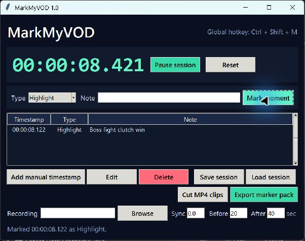

# MarkMyVOD Lite

Mark stream highlights while you play, then export a clean CSV or YouTube chapter list without uploading your footage.



The screenshot shows the full MarkMyVOD interface. Lite uses the same marker workflow but excludes the paid JSON, EDL, and MP4 clip-export features described below.

## Download

Download the latest Windows ZIP from [GitHub Releases](https://github.com/jblaz6335/markmyvod-lite/releases/latest).

Software catalogs and reviewers can use the canonical [PAD feed](markmyvod-lite.xml) for machine-readable release metadata and automatic update checks.

### Package managers

The maintained Chocolatey and WinGet package sources are available under [`packaging`](packaging/). While their community submissions are under preparation, Scoop users can install the verified release directly from this repository:

```powershell
scoop install https://raw.githubusercontent.com/jblaz6335/markmyvod-lite/main/packaging/scoop/markmyvod-lite.json
```

The Scoop manifest verifies the same SHA-256 digest published in the release notes and creates a Start menu shortcut named **MarkMyVOD Lite**.

## Included in Lite

- Global `Ctrl + Shift + M` marker hotkey on Windows
- Up to 10 timestamped markers per session
- Marker types, notes, manual timestamps, editing, and deletion
- Session save and restore
- CSV and YouTube chapter exports
- No account, cloud upload, tracking, ads, or generated media

## Quick start

1. Unzip the release.
2. Open `MarkMyVODLite.exe` when your recording starts.
3. Click **Start session**.
4. Press `Ctrl + Shift + M` whenever something worth clipping happens.
5. Export CSV and chapters after the stream.

Windows may show an unsigned-app warning because this independent build is not code-signed.

## Full version

The [$5 full version](https://blazalgosystems.itch.io/markmyvod) removes the marker limit and adds JSON, CMX 3600 EDL, and exact local MP4 clip export through FFmpeg.

If Lite saves you time and you do not need the full version, you can optionally [support Blaz Algo Systems on Ko-fi](https://ko-fi.com/C2A325JGKN/).

## Requirements

- Windows 10 or Windows 11
- No installer and no account
- No FFmpeg required for Lite

## Privacy and security

MarkMyVOD Lite does not connect to the internet unless the user clicks the full-version button. Session files and marker exports stay on the local computer. See [SECURITY.md](SECURITY.md) for reporting guidance.

## License

MarkMyVOD Lite is freeware. Redistribution is allowed only for the original, unmodified release ZIP. See [LICENSE](LICENSE).
